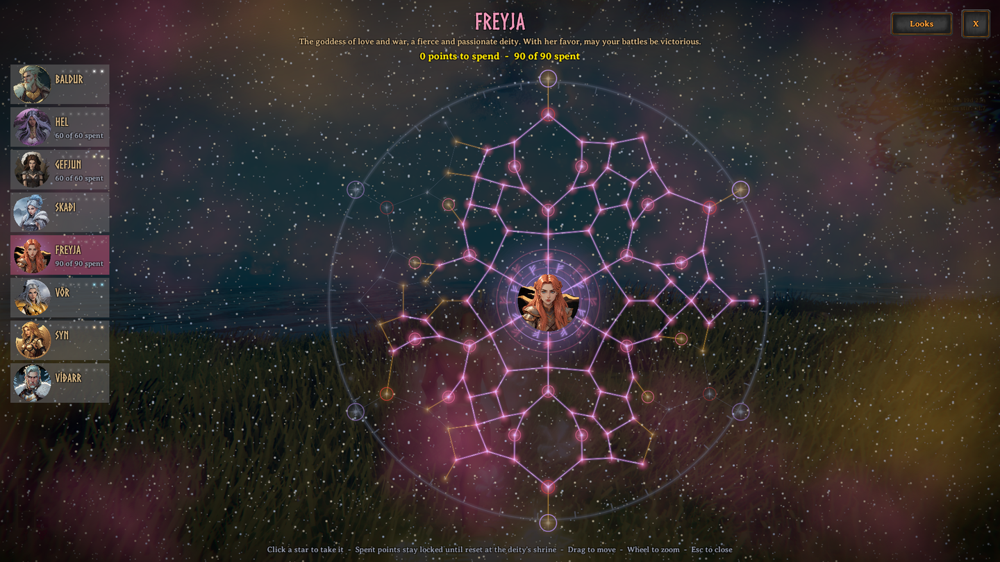
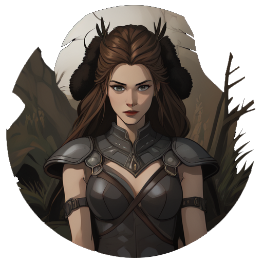
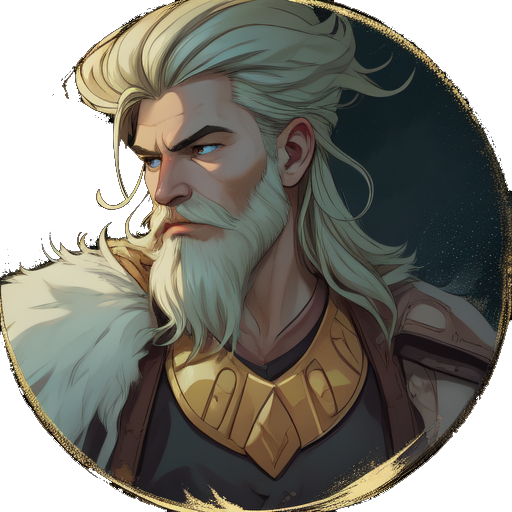
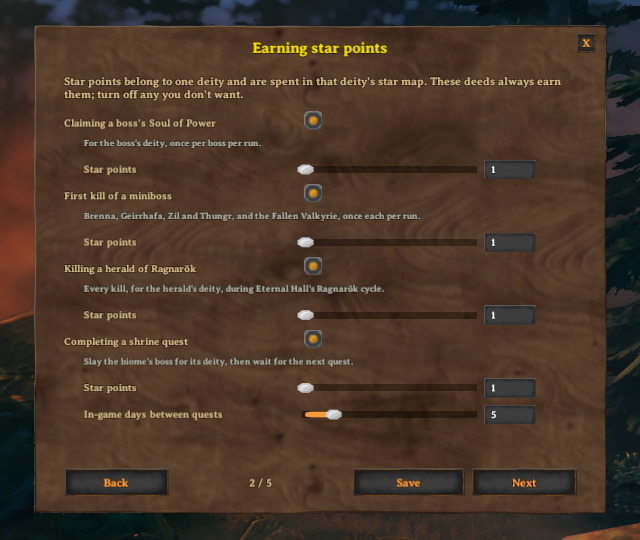

# Aesir Lineage
The successor to Valhalla Eternal, which is no longer updated.

What if killing the final boss was not the end of the game? Pledge yourself to the Norse gods: earn each deity's favour, spend it in their star map, swear oaths for greater power, and Ascend to start over in a god's name. Some would call it a New Game+; others, the boons of Hades brought to Valheim.

The mod aims to stay close to even on power. It can make your journey much easier, but its oaths and Ascension also let you make the game harder as you go.

 

## Features
- **A star map for each deity.** Earn a deity's star points and spend them on linked stars. Open it with K, the star button at the end of the inventory's row of round buttons, or any shrine.
- **Oaths.** The strongest stars come with a vow you must keep while you hold them, and make the game harder.
- **Shrines in every biome.** Take the deity's quest to slay the biome's boss, then come back each day for a short blessing.
- **Deeds the gods notice.** A sure point for every boss's Soul of Power and the first kill of each miniboss, and rare luck on starred kills, crafting and harvesting.
- **Dreams.** A deity you are devoted to may visit you in your sleep and lend you a stronger boon for a while.
- **Ascension.** Once every boss has fallen, start over in a deity's name to open their final stars and keep their looks for good. Your level is shown to other players.
- **Looks.** Each deity's aura, wings, footprints, weapon glow and kill effect, earned with their stars and chosen in the star map. Purely for show, and a server can turn them off.
- **Quick setup.** A short tutorial on first launch chooses how your world plays, and opens again any time from Mod Config.
- **An optional progression lock.** Gear, food and building from each biome stay sealed until you defeat the boss before it.
- **Eternal Hall.** Its heralds of Ragnarök give star points, and each Ascension brings its Ragnarök closer.

## The deities
Eight deities, one for each biome. Each has shrines in their biome, a star map of six paths and their own looks.

|  |  |  |  |
| :-: | :-: | :-: | :-: |
|  **Gefjun** · Meadows _Ploughing, harvest and protection_ |  **Vör** · Black Forest _Curiosity, wisdom and certainty_ |  **Baldur** · Swamp _Light, purity and invincibility_ |  **Skaði** · Mountains _Winter, mountains and the hunt_ |
|  **Syn** · Plains _Refusal, protection and Valhalla's doors_ |  **Freyja** · Mistlands _Love, war and seiðr magic_ |  **Hel** · Ashlands _Death and the dead who did not fall in battle_ |  **Víðarr** · Deep North _Silence, vengeance and the world after_ |

## Quick setup

The first time you start the game with Aesir Lineage, a short setup opens on the main menu. Its pages cover the choices most worlds make:

  | Page | Chooses |
  | ----------- | ----------- |
  | Earning star points | Which deeds always give points, and how many: Souls of Power, minibosses, heralds of Ragnarök and shrine quests |
  | Lucky star points | Whether starred kills, crafting and harvesting can give points by luck, how often, and how many per deity each run |
  | Deity looks | Whether anyone shows their deity looks |
  | Ascension and Ragnarök | How many times a player can Ascend with each deity, what Ascending costs, and whether it brings Eternal Hall's Ragnarök closer |

- Nothing changes until you save, and closing with unsaved changes asks first.
- Open it again any time from the **Mod Config** button at the bottom right of the main menu, or of the pause menu while you host or are a server admin. A host's or admin's save reaches everyone on the server.
- On the main menu it changes this game's own settings, which your worlds and any server you host use. On someone else's server, that server's settings win.
- It opens by itself once for each person on the computer, whatever the mod manager profile. `FirstRunPopup` shows it again on the next launch, or never; `ShowQuickConfigButton` takes it off the Mod Config list.

## Earning star points
Star points belong to one deity and are spent in that deity's star map. A _run_ lasts until you Ascend; Ascending starts a new one.

  | Source | Points |
  | ----------- | ----------- |
  | Claiming a boss's Soul of Power | 1, once per boss per run |
  | First kill of a miniboss (Brenna, Geirrhafa, Zil and Thungr, the Fallen Valkyrie) | 1, once per miniboss per run |
  | Killing a herald of Ragnarök (with Eternal Hall's Ragnarök cycle) | 1 for the herald's deity, every kill |
  | Completing a shrine quest | 1, with a new quest every 5 in-game days |
  | Killing an enemy with 2 or more stars, at or above your biome level | 5% chance of 1 |
  | Crafting or upgrading an item | 1% chance of 1 |
  | Harvesting: picking crops, berries and herbs, felling trees, breaking rocks and ore deposits | 0.2% chance of 1 |
  | Ascending with a deity | 3 |

- Lucky points (starred kills, crafting and harvesting) are limited to 5 per deity per run.
- A kill or harvest counts for the deity of the biome it happened in. A lucky craft goes to a random deity whose biome you have found.
- Your biome level is the biome after the last boss you have beaten. Beat Eikthyr and the Elder, and only starred kills in the Swamp and beyond count.
- Tamable and passive creatures never count.
- A boss leaves its Soul of Power whenever someone nearby hasn't claimed it yet this run. Claiming it gives you a player key for that boss (`al_claimed_<boss>`), which Ascending removes.
- Every number here is a server setting.
- Admins can give star points to any player who is online with `al-give-points <player> <deity> <amount>`, or take them away with `al-remove-points <player> <deity> <amount>`. If what is left no longer covers the stars a player holds with that deity, their star map for it is reset so they can spend what remains.

## Ascension
Once every boss has fallen, any shrine offers to **Ascend** with its deity: start a new run in that deity's name, up to 6 times each (`MaxAscension`).
- Each level opens one of the deity's final stars, gives 3 of their star points, and keeps one of their looks for good: the aura at level 1, then footprints, weapon glow, kill effect and wings.
- The price, each a server setting: half of every skill (`AscensionSkillLoss`), the recipes you know (`AscensionForgetsRecipes`), a return to the start (`AscensionReturnsToStart`), and every boss to be defeated again (`AscensionRemovesBossKeys`, the world's keys on a shared world).
- Every Soul of Power can be claimed again, and quests, blessings and lucky rewards start over.
- **Ragnarök.** With Eternal Hall's Ragnarök cycle running, each Ascension brings Ragnarök 3 in-game days closer for everyone (`AscensionRagnarokDays`), and everyone is told who brought it. If that would pass the end of the countdown, Ragnarök comes in half a day instead; a countdown already closer than that is left alone. The shrine warns before you Ascend. Turn it off with `AscensionAdvancesRagnarok`.

## Looks
Major, oath-bound and final stars bring their deity's looks: an aura, wings, footprints, a weapon glow and a kill effect. Choose which deity's look to wear in each place, or none, with the star map's **Looks** button. Ascension keeps a look for good, and grows it with each level. Other players see your looks.

A server can turn looks off for everyone with `EnableLooks`. Nobody then shows any and the star map has no Looks button; players keep the looks they earned, so turning it back on brings them back.

## Shrines
Each biome has shrines to its deity. At a shrine you can:
- **Take the deity's quest.** Slay the biome's boss, either landing a hit or standing nearby when it falls. There is no time limit, and the next quest is ready 5 in-game days after you took the last one.
- **Receive the deity's blessing.** Once you have completed the deity's quest this run, its shrine blesses you once per in-game day for 10 minutes. Each blessing helps with going back to that biome.
- **Reset the deity's star map** with the shrine's Reset Stars button, for one of the biome's great trophies. Points spent on stars are locked until then; a reset gives back every star you hold with that deity, and the button asks twice before it takes the trophy.
- **Ascend with the deity**, once every boss has fallen.

  | Deity | Blessing | Effects |
  | ----------- | ----------- | ----------- |
  | Gefjun | Blessing of the Plough | +100 carry weight; 10% chance of extra wood, stone and ore; 10% chance of a double harvest |
  | Vör | Vör's Sight | Ore within 50 m is marked on your map; reveal the map 30% farther; 10% harder to notice while sneaking |
  | Baldur | Baldur's Purity | 20% less damage from burning and poison; wet wears off 50% sooner; +15% damage to undead |
  | Skaði | Skaði's Mantle | Immune to cold and freezing; 15% less frost damage; running costs 10% less stamina |
  | Syn | Syn's Ward | +15% block power; 20% harder to stagger; +6 armor |
  | Freyja | The Falcon Cloak | Glide while falling; jumping costs 25% less stamina; +15% eitr regeneration |
  | Hel | Hel's Embrace | 25% resistance to Ashlands heat; 20% less fire damage |
  | Víðarr | Víðarr's Stride | Deep snow slows you 50% less; cold slows your regeneration 50% less; 15% less frost damage |

## Dreams
Once you have earned 4 star points with a deity, it may visit you in a dream. Each time you sleep there is a 15% chance of a dream, from a deity picked by how devoted you are to it. You wake with its inspiration for 30 minutes. Only one inspiration can be on at a time.

  | Deity | Dream | Effects |
  | ----------- | ----------- | ----------- |
  | Gefjun | The Long Table | Food gives 15% more health, stamina and eitr; 20% chance of a double harvest |
  | Vör | The Knowing | +30% skill experience; 5% chance for a hit to be critical |
  | Baldur | The Shining | +20% block power; +20% health regeneration; +20% damage to undead |
  | Skaði | The Huntress | +15% bow damage; bows draw 15% faster; running costs 15% less stamina |
  | Syn | The Threshold | 40% harder to stagger; +12% melee damage |
  | Freyja | Sessrúmnir | +20% stamina and eitr regeneration; +12% magic damage |
  | Hel | Hel's Harvest | Heal for 2% of the damage you deal; +20% damage to enemies below 30% health |
  | Víðarr | The Silent Vow | +20% unarmed damage; cold slows your regeneration 30% less |

Blessings and dreams can be changed or added to in `Shrines.yaml` when `UseShrinesFile` is on.

## Progression lock
Off unless a server turns on `EnableProgressionLock`. With it on, everything made from a biome's materials is sealed until you defeat the boss before that biome: bronze, troll hide and blueberries need Eikthyr, iron and turnips need the Elder, and so on up to Fader for the Deep North. A boss's own drops need that boss, and each tier of battle and protection idols needs the boss of its tier. Anything made from sealed materials is sealed too, followed down through every recipe and through cooking, baking, fermenting and smelting, so items from other mods are sealed by what they are made of.

A sealed item's tooltip names the boss that opens it, and trying to use it tells you the same. Each part can be turned off on its own:

  | Setting | Seals |
  | ----------- | ----------- |
  | `LockEquipment` | Equipping weapons, armor, tools and ammo, and opening doors with a boss's key. Sealed gear you are wearing comes off |
  | `LockConsumables` | Eating food and drinking meads |
  | `LockCrafting` | Crafting and upgrading at every station, cooking on cooking stations and ovens, and fermenting |
  | `LockBuilding` | Placing build pieces |

- **Whose kills count** (`ProgressionLockSource`). _Personal_, the default: only the bosses you helped defeat, by landing a hit or standing nearby when it fell, the same as for shrine quests. Each one gives you that boss's player key (`defeated_eikthyr` and so on), which Ascending removes when `AscensionRemovesBossKeys` is on, so each new run is sealed again. _World_: every boss defeated in the world counts as well.
- **Your own list** (`ProgressionLockItems`): `prefab=bosskey` pairs, separated by commas, change which boss an item or build piece needs. `SwordIron=defeated_bonemass` seals the iron sword until Bonemass; `SwordIron=` never seals it. A material's boss also seals everything made from it.
- **Characters from before.** The game itself gives a boss's player key only to the one player whose game runs the boss. If a character beat bosses before the lock was on and finds their gear sealed, an admin can give the key with `setkeyplayer defeated_<boss>` while playing that character.
- Admins can check it with `al-locks`: on its own it shows the last boss you have defeated, `al-locks <prefab>` shows which boss an item or build piece needs, and `al-locks dump` writes every sealed item and piece to the log, by boss.

## Compatibility
Can you use this with Epicloot? Can you use this with Jewelcrafting? _**Absolutely**_! I can't promise there will be no bugs or conflicts, but I am always interested in addressing those.

- With Auga, the star map's button is in the row of buttons under your character's name.
- World Advancement Progression has a progression lock of its own. Turn on one of the two, not both.
- With Eternal Hall, heralds of Ragnarök give star points and Ascension brings Ragnarök closer.

### Suggested mod pairing
- [World Advancement Progression](https://thunderstore.io/c/valheim/p/VentureValheim/World_Advancement_Progression/) - Make the NG+ part less of a breeze
- [Eternal Hall](https://thunderstore.io/c/valheim/p/MidnightMods/EternalHall/) - Personal boss islands, and a Ragnarök that remakes the world on a timer
- [Deathlink](https://thunderstore.io/c/valheim/p/MidnightMods/Deathlink/) - Let each player choose their death risks and rewards
- [Impactful Skills](https://thunderstore.io/c/valheim/p/MidnightMods/ImpactfulSkills/) - Make leveling up your skills more rewarding by giving them all more useful features
- [Star Level Systems](https://thunderstore.io/c/valheim/p/MidnightMods/StarLevelSystem/) - Expand creature levels, configure everything creature and loot related

---

## Each deity's stars
Each deity has a star map of six paths leading out from their portrait, one for each side of the deity. Small stars along each path give small bonuses, and small stars between neighbouring paths let a build cross from one to the next. Below are the named stars on each path: its major stars, then an oath-bound star that is strong but carries an oath, then a final star that opens with Ascension (the level it needs is shown). The numbers are the defaults; the star map shows what each star would change for you, with a longer explanation of how each power works both before and after you take it. Each tier of star (small, major, oath-bound and final) has its own sound when taken, the same for every deity.

### Gefjun | Meadows
Goddess Of Plowing, Agriculture & Protection

Gefjun ploughed Zealand out of the earth with her four sons yoked as oxen. Her stars reward the harvest, the hearth and the household.

**The Furrow** · gathering
- **Bounty of the Lands**: 10% chance of an extra harvest when picking
- **Seeds of the Gods**: crops you plant grow in any biome, heat or cold
- **Fishing Prosperity**: 10% chance of a bonus find when you land a fish
- **Yoke of the Four Oxen** (oath-bound): +150 carry weight, and a 15% chance that a hit on a tree, rock or ore throws off an extra piece. _Oath: deal 15% less damage._
- **Bloom of Zealand** (Ascension 6): once every 10 minutes a killing blow leaves you at 1 health and roots enemies within 6 m for 3 seconds. _Oath: deal 20% less damage._

**Herd** · taming, breeding and draught beasts
- **Ox-Mother**: creatures within 30 m of you tame 25% faster, and tames within 20 m take 15% less damage
- **Fruitful Herd**: tames within 30 m of you breed and grow up 25% faster
- **Draught Ox**: carts you or your tames pull are 30% lighter; crouch as you take a cart's handle to harness a tame following you to it
- **Never Hungry** (oath-bound): tames within 30 m of you stay fed. _Oath: food burns down 20% faster._
- **The Four Oxen** (Ascension 1): each tame within 20 m, up to four, gives +50 carry weight and 4% less damage taken. _Oath: deal 15% less damage._

**The Long Table** · food
- **Quality Nourishment**: food gives 8% more health, stamina and eitr
- **Hearty Meal**: your strongest food gives 35% more health
- **Gefjun's Feast**: eating heals players within 6 m for 10% of the food's health
- **Feastbound** (oath-bound): food gives 25% more health, stamina and eitr. _Oath: food burns down 25% faster._
- **Hearth-Mother** (Ascension 2): players within 8 m gain 15% of your food health. _Oath: take 15% more damage._

**Homestead** · the hearth, the working household and the hives
- **Well-Rested**: +1 comfort, and Rested lasts 25% longer
- **Hearth Strength**: while rested, each comfort level gives +0.5% damage and stamina regeneration
- **Busy Household**: smelters, kilns, ovens, fermenters and cooking stations within 15 m of you work 20% faster
- **Hermit** (oath-bound): +2 comfort, and hives and crops within 30 m of your bed give 25% more. _Oath: move 10% slower._
- **The Swarm** (Ascension 5): bees sting enemies within 4 m of you every second, each sting a 10 dose of poison that renews rather than stacks, twice as strong within 30 m of a beehive. _Oath: 20% less max stamina._

**Zealand's Ward** · protection
- **Basic Protection**: +6 armor
- **Shelter**: below 35% health, take 15% less damage
- **Hearth Guard**: +6 armor, and blocking costs 8% less stamina
- **Mother's Ward** (oath-bound): each block builds a stack of Fortification, each stack 3% less damage taken, up to 5, lasting 10 seconds. _Oath: move 10% slower._
- **The Plough** (Ascension 4): a two-handed weapon's secondary attack cuts a furrow 8 m ahead, striking each enemy along it for 120% of the weapon's damage. _Oath: 25% less stamina regeneration._

**Land-taker** · axes, pickaxes and the load you carry
- **Clear the Land**: +15% damage to trees, logs, rock and ore, and axes and pickaxes cost 15% less stamina
- **Rich Seam**: 8% chance that a hit on a tree, rock or ore throws off an extra piece
- **Furrow Stride**: on paths, roads and tilled ground, move 10% faster and running costs 20% less stamina
- **Ox-strength** (oath-bound): over your carry limit you don't slow down; the extra weight costs stamina instead. _Oath: 25% less stamina regeneration._
- **Bearer of the Land** (Ascension 3): +1% damage for every 25 kg you carry, up to 20%. _Oath: move 15% slower._

---

### Vör | Black Forest
Goddess of Curiosity, Wisdom & Certainty

Nothing can be hidden from Vör. Her stars reward learning, careful work and knowing exactly where to strike.

**Insight** · skills
- **Wisdom of the Ages**: 10% chance to gain skill experience twice
- **Bladebound Knowledge**: 10% chance that combat skill experience also trains a non-combat skill
- **Hunger for Knowledge**: 25% chance that a new recipe trains a random skill
- **Eureka**: 10% chance that a skill level-up brings a second level
- **Certainty** (oath-bound): +40% skill experience. _Oath: lose twice as much skill when you die._
- **Völuspá** (Ascension 2): a skill level-up gives 20% more damage and skill experience for 10 seconds. _Oath: food burns down 15% faster._

**Careful Hand** · crafting and keeping gear
- **Lasting Make**: your gear wears 25% slower and has 10% more durability
- **Thrifty Craft**: 10% chance that crafting or upgrading costs nothing
- **Masterwork**: 10% chance that a weapon or armor you craft or upgrade is a masterwork, with 10% more damage or armor
- **Exacting** (oath-bound): every weapon or armor you craft or upgrade is a masterwork. _Oath: crafting and upgrading cost 50% more of each material, always at least one more._
- **Weapon-lore** (Ascension 1): each weapon gains +1% damage for every 50 kills made with it, up to 20%. _Oath: weapons and armor someone else made give 20% less._

**Lore of War** · precision
- **Knowledge Is Power**: combat skills gain 10% of your best non-combat skill as extra levels, up to 10
- **Learned from the Fallen**: killing a starred creature gives 5% more damage per star for 20 seconds
- **Certain Blow** (oath-bound): every hit is critical, but critical hits deal only 25% more
- **Foresight** (Ascension 6): an enemy's first hit on you misses, and misses again once it has gone 20 seconds without hitting you. _Oath: 20% less max health._

**Weak Points** · where to strike
- **Unseen Edge**: sneak attacks deal 50% more
- **Know Thy Foe**: +15% to each damage type a creature is weak to
- **Keep the Secret**: hitting an unaware enemy makes no noise, so killing it doesn't alert the others
- **First Cut** (oath-bound): sneak attacks on unaware enemies are always critical. _Oath: deal 15% less damage to enemies that are aware of you._
- **Read the Fight** (Ascension 5): hits on a staggered enemy count as sneak attacks. _Oath: 20% less max health._

**Nothing Hidden** · perception
- **Ore Sense**: ore within 40 m is marked on your map
- **Tracks**: the last creature you hit stays marked on your map for a minute
- **The Seeress's Map**: chests, dungeon entrances and creatures of two stars or more within 80 m are marked on your map
- **Raven's Eye** (oath-bound): once a minute, the map is revealed 150 m around you. _Oath: gain 25% less combat skill experience._
- **Unveiling** (Ascension 3): each hit marks the enemy for 6 seconds, and you deal 2% more damage to it per mark, up to 5. _Oath: gain 25% less skill experience._

**Vows** · the oaths you carry, in any deity's map
- **Keeper of Vows**: +3% damage and skill experience for each star you hold with an oath, up to six
- **Bound Word**: your oaths that weaken you by an amount are 15% lighter
- **Grudge**: an enemy that hurts you takes 20% more from you for 20 seconds
- **Vár's Witness** (oath-bound): players and tames within 10 m gain half your Keeper of Vows bonus. _Oath: 10% less max health._
- **Oath-ring** (Ascension 4): you always have at least as many stacks of Fortification as stars you hold with an oath, each stack 2% less damage taken, up to 5. _Oath: lose 50% more skill when you die._

---

### Baldur | Swamp
God of Light, Purity & Invincibility

Everything in the world swore never to harm Baldur, all but the mistletoe. His stars burn the undead, keep others whole and carry his ship.

**Radiance** · against the undead
- **Light of Baldur**: +15% damage to undead
- **Sunstrike**: critical hits on undead call down light for 50% of the hit as spirit damage
- **Cleansing Flame**: undead you kill burst into light, hitting enemies within 4 m for 20% of their health, half as fire and half as spirit
- **Sunsworn** (oath-bound): +6 spirit damage on every hit. _Oath: deal 20% less damage at night._
- **Dawnbringer** (Ascension 3): a light surrounds you, and undead within 6 m take 8 spirit damage each second. _Oath: you can't sneak._

**Breiðablik** · healing and keeping others whole
- **Breiðablik**: you and players within 8 m regenerate health 15% faster and take 25% less from burning and poison, and tames there heal over time
- **Mercy**: 10% of your hits heal the most hurt player or tame within 10 m, you included, for 30% of the damage
- **Safe Haven**: other players and tames within 6 m take 10% less damage
- **Selfless** (oath-bound): other players and tames within 8 m heal 1% of their health a second. _Oath: 50% less health regeneration._
- **All Things Wept** (Ascension 5): another player or a tame within 15 m that drops below 20% health is healed to half, once every 3 minutes each. _Oath: 20% less max health._

**Purity** · cleansing
- **Purify**: 15% less damage from burning and poison
- **Cleanse Wet**: being wet wears off 40% sooner
- **Clean Parry**: a parry removes one ailment: burning, poison, frost, shock, spirit, wet, smoke or tar
- **Untainted** (oath-bound): poison can't touch you. _Oath: your hits deal no poison damage._
- **Bright Retort** (Ascension 2): a parry staggers every enemy within 4 m. _Oath: 25% less stamina regeneration._

**Hringhorni** · sailing and the sea
- **Hringhorni**: ships you steer sail 15% faster
- **Steady Keel**: ships you steer take 50% less damage from waves, rocks and capsizing
- **Sea-born**: swim 25% faster, and swimming costs 30% less stamina
- **Fair Wind Always** (oath-bound): the wind always fills the sail of a ship you steer. _Oath: take 25% more fire damage._
- **Ship-Caller** (Ascension 1): at the shore, the Call Ship key (Y) brings the last ship you steered to the water nearest you, once every 10 minutes. _Oath: 20% less max health._

**Invincibility** · shields
- **Shield Wall**: +15% block power
- **Arrow Catcher**: every fifth ranged hit you take does 40% less damage
- **Returned Light**: parrying a projectile strikes the shooter for 50% of the blocked damage as spirit
- **Oath of All Things** (oath-bound): the first hit every 20 seconds is ignored. _Oath: take 50% more pierce damage._
- **Invincible** (Ascension 6): when a hit drops you below 20% health, nothing can hurt you for 3 seconds, once every 5 minutes. _Oath: 20% less max health._

**Dawn** · sunlight, torches and the mist burned away
- **Sun-kissed**: in direct sunlight, +15% health and stamina regeneration and +5% damage
- **Torchbearer**: a held torch warms you like a fire, never burns out, and its fire is 50% stronger
- **Mist-burner**: the Mistlands mist clears 20 m around you
- **Bifröst** (oath-bound): when rain stops near dawn or dusk, a rainbow raises the health and stamina regeneration of players within 30 m for 5 minutes. _Oath: 25% less eitr regeneration._
- **Radiant Judgment** (Ascension 4): once every 2 minutes, a secondary attack calls down light on every enemy within 20 m for 50% of your weapon's damage as spirit. _Oath: take 20% more damage at night._

---

### Skaði | Mountains
Goddess of Winter, Mountains & Hunting

Skaði hunts on skis through the mountains of Þrymheimr. Her stars reward the bow, the spear, the cold and the pack.

**The Hunt** · bows
- **Huntress Prowess**: 10% chance to get back an arrow or bolt when you kill while holding a bow or crossbow
- **Piercing Shot**: arrows also hit the nearest enemy behind the target for 40% of the hit
- **Field Dressing**: what creatures you kill with a bow or crossbow drop goes into your bag
- **Rain of the North** (oath-bound): bows loose 2 extra arrows, spread a little wider. _Oath: bows draw 50% slower and deal 50% less damage._
- **Hang on the Wind** (Ascension 4): drawing a bow in mid-air all but stops your fall. _Oath: deal 20% less melee damage._

**Quarry** · hides, meat and trophies
- **Skinner**: 15% chance that a kill drops an extra hide, leather, scale or meat
- **Trophy Hunter**: trophies drop 25% more often, and a kill in one hit always drops one
- **Hunter's Fare**: meat dishes give 15% more health and stamina
- **Call of the Hunt** (oath-bound): wild creatures that come within 30 m of you gain a star, once each: more loot and experience, and a harder fight
- **Þjazi's Eyes** (Ascension 1): +5% damage to a creature whose trophy you carry. _Oath: 15% less max health._

**Winter** · cold
- **Swift is the Shadow**: +8% run speed at night, in the mountains and in the Deep North
- **Stormbound Rage**: in storms your hits deal 10% extra as lightning, or as frost in snowstorms
- **Shatter**: enemies killed by a frost hit shatter, hitting enemies within 4 m for 20% of their health as frost
- **Child of Þrymheimr** (oath-bound): cold and freezing can't touch you. _Oath: take 50% more fire damage._
- **Winter's Shatter** (Ascension 6): bow and crossbow kills burst into frost, hitting enemies within 6 m for 30% of the victim's health. _Oath: take 30% more fire damage._

**Spear** · the thrown spear
- **Huntress's Spear**: thrown spears fly 25% faster, and +15% spear damage
- **Returning Spear**: a thrown spear comes back to your hand when it lands
- **Pinning Throw**: 50% chance that a thrown spear roots what it hits for 3 seconds
- **Long Hunt** (oath-bound): a thrown spear also strikes every enemy in a line 6 m behind what it hits. _Oath: bows deal 25% less damage._
- **Winter Spear** (Ascension 5): where a thrown spear lands, ice bursts, hitting enemies within 4 m for 60% of the throw as frost. _Oath: you can't block._

**The Peaks** · movement
- **Sure-footed**: you take no fall damage
- **Skis of Skaði**: in the mountains and the Deep North, running costs 30% less stamina and you move faster by a fifth of that
- **Leap**: jumps while running go 25% higher
- **Mountain-born** (oath-bound): jump again in mid-air. _Oath: -100 carry weight._
- **Wolf-Sister** (Ascension 2): three bow or crossbow kills within 20 seconds call a wolf to hunt beside you for a minute. _Oath: 15% less max health._

**Pack** · wolves and the beasts that hunt beside you
- **Pack-leader**: tames following you deal 15% more damage and take 15% less
- **Pack Tactics**: +10% damage to an enemy next to one of your tames, and your tames go for what you hit
- **Lick Wounds**: with no enemy near, tames following you heal 3% of their health a second
- **Pack-bound** (oath-bound): tames following you take 40% less damage. _Oath: take 15% more damage._
- **Endless Pack** (Ascension 3): a killing blow leaves a tame following you at 1 health and unharmed for 10 seconds, once a minute each, and the wolves Wolf-Sister calls stay. _Oath: 25% less stamina regeneration._

---

### Syn | Plains
Goddess of Refusal, Protection & Guardian of Valhalla

Syn guards the doors of the hall and turns away those she will not admit. Her stars reward standing firm, the shield, the polearm and the blade.

**Refusal** · poise
- **Built Different**: it takes 20% more to stagger you
- **Ever Watchful**: 25% less damage taken while staggered
- **Footing**: while blocking, stagger is paid with stamina when you have enough
- **The Unmoving Door** (oath-bound): you can't be staggered. _Oath: move 25% slower._
- **Stone Skin** (Ascension 2): standing still for a second fills your Fortification, each stack 4% less damage taken, up to 5. _Oath: move 15% slower._

**Warden** · your buildings and the raids against them
- **Hall-ward**: while you are near, buildings you made take 20% less damage and don't rot in the rain
- **Defender of the Hall**: inside a raid, whoever it came for, deal 15% more damage and take 15% less
- **Mend the Walls**: a kill mends the most damaged building of yours within 10 m, and repairing one repairs all of yours within 8 m
- **The Barred Hall** (oath-bound): raiders going for a building within 30 m of you come for you instead, and you take 25% less from them. _Oath: move 10% slower._
- **Ban the Kind** (Ascension 1): hang a creature's trophy on an item stand you built, and that kind can't damage your buildings while you're near and takes 25% more from you. _Oath: while a kind is banned, deal 10% less damage to every other kind._

**The Gate** · shields
- **Guardian of the Gates**: +15% block power with tower shields
- **Brutal Defiance**: every third block within 6 seconds releases a burst, hitting enemies within 3 m for 60% of your block power
- **Sealed Wall**: blocking with a tower shield turns aside 50% of elemental, poison and spirit damage
- **The Shut Door** (oath-bound): blocking strikes the attacker for 30% of the damage blocked. _Oath: deal 15% less damage._
- **Doors of Valhalla** (Ascension 4): while you block, a rune dome covers players within 4 m, who take 20% less damage. _Oath: deal 20% less damage._

**Polearm** · hold the line
- **Gate-guard's Reach**: polearms deal 15% more damage and knock back further
- **Set Against the Charge**: holding a polearm, the first enemy to close within 3 m is staggered, once every 10 seconds
- **Sweeping Ward**: each enemy your polearm hits gives a stack of Fortification, each stack 2% less damage taken, up to 5, lasting 10 seconds
- **Wall of Spears** (oath-bound): polearm attacks reach 25% wider and deal 25% more. _Oath: dodging costs 50% more stamina._
- **Hold the Gate** (Ascension 3): while you stand still, polearm hits knock enemies back twice as far and slow them by half for 3 seconds. _Oath: move 15% slower._

**Blade and Hoard** · melee and wealth
- **Wealth of the Ages**: 5% chance that your kills drop coins or valuables
- **Strength of the Valkyries**: each weapon skill counts as higher by 10% of your best other weapon skill, up to 10 levels
- **Challenge**: creatures you hit turn on you
- **Dedication to the Blade** (oath-bound): +25% melee damage. _Oath: you can't use bows or crossbows._
- **The Last Door** (Ascension 6): once every 5 minutes, you take the killing blow meant for a player within 10 m. _Oath: take 15% more damage._

**Denial** · what you deny the enemy
- **Refuse**: an enemy you hit deals 15% less damage to you for 5 seconds
- **Armour Break**: each blunt hit breaks an enemy's guard a little more, +3% damage from you per break; the fifth staggers it and starts again
- **Interrupt**: hits on an enemy in the middle of an attack stagger it 50% more
- **Mirror of Refusal** (oath-bound): 15% chance that half of what hurts you is sent back at the attacker. _Oath: 10% less max health._
- **Verdict** (Ascension 5): every fifth hit on the same enemy passes judgment, and it takes 25% more from you for 10 seconds. _Oath: 20% less max stamina._

---

### Freyja | Mistlands
Goddess of Love, Sex, Beauty, War & Seiðr Magic

Freyja works seiðr, chooses half the slain for Fólkvangr, wears Brísingamen and flies in a falcon cloak. Her stars reward magic, meads, war, love and gold.

**Seiðr** · magic
- **Seiðr of Plenty**: +15 eitr and +15% eitr regeneration
- **Echo**: 15% chance that a spell casts again at once, for free
- **Storm-weave**: in rain or water, your lightning arcs to wet enemies within 6 m for 40% of its damage
- **Völva's Price** (oath-bound): when eitr runs short, spells take the rest from your health. _Oath: 20% less max health._
- **Brísingamen** (Ascension 4): while your eitr is above half, it takes damage before your health. _Oath: 30% less eitr regeneration._

**Cauldron** · meads and potions
- **Völva's Brew**: mead effects last 25% longer and restore 15% more
- **Quick Draught**: healing meads come off cooldown 25% sooner
- **Last Drop**: 15% chance that a mead isn't used up
- **Twice-brewed** (oath-bound): a fermenter you tap gives one more. _Oath: 20% less max eitr._
- **Elixir of Seiðr** (Ascension 2): each mead you drink gives 20% more damage for 10 seconds and clears one ailment. _Oath: food burns down 15% faster._

**War** · battle
- **Goddess of War**: +15% stamina regeneration and +10% health regeneration
- **Perfect Form**: about every 500 damage you deal, one hit does 50% more
- **Battle Fury**: each hit builds fury, 1% more damage per stack up to 20; it fades after 4 seconds without a hit
- **Chooser of the Slain** (oath-bound): kills heal you for 8% of your max health. _Oath: take 15% more damage._
- **Fólkvangr** (Ascension 6): 50% chance that a kill calls an einherjar to fight beside you for 20 seconds. _Oath: 20% less max health._

**Bond** · the one at your side
- **Bonded**: the nearest player within 15 m, or else a tame, is your bonded one; you, and a bonded player, gain 10% stamina regeneration and speed
- **Shared Burden**: 20% of the damage your bonded one takes is moved to you
- **Seiðr Link**: 50% of healing past your full health flows to your bonded one
- **Inseparable** (oath-bound): within 10 m of your bonded one, deal 15% more damage and take 10% less. _Oath: deal 15% less damage with no bonded one near._
- **Longing for Óðr** (Ascension 1): when your bonded one or another player near you falls below 20% health or dies, deal 40% more damage and heal for some of it for 20 seconds. _Oath: take 15% more damage._

**Falcon** · grace
- **Falcon Glide**: hold jump while falling to glide
- **Beloved**: the effect of anything you consume, meads above all, also reaches players within 6 m
- **Battle Medic**: while you block, other players within 5 m heal 2 health a second
- **Charged Grace** (oath-bound): a dodge or parry charges your next hit: 25% more damage, and half the hit splashes onto enemies close by. _Oath: 20% less armor._
- **Falcon Form** (Ascension 3): hold jump to hover, at a cost in stamina. _Oath: 30% less stamina regeneration._

**Tears of Gold** · trade, treasure and the hoard
- **Dwarves' Bargain**: traders sell to you 15% cheaper and pay 15% more
- **Gersemi**: 15% chance that a world chest you open for the first time holds an extra valuable
- **Hoard**: coins weigh nothing, and every 200 you carry give +1 armor, up to 10
- **Gold-hunger** (oath-bound): +1% damage for every 100 coins you carry, up to 25%. _Oath: your coins are lost when you die, not left in your grave._
- **Tears of Red Gold** (Ascension 5): while you carry coins, 25% of the damage you take is paid with 5 coins a point instead. _Oath: 20% less armor._

---

### Hel | Ashlands
Goddess of Death and Ruler of the Damned in the Underworld

Hel is half living and half dead, and rules everyone who did not die in battle. Her stars reward fire, poison, the risen dead and the night.

**Hellfire** · heat
- **Hellfire Adaptation**: 15% resistance to Ashlands heat
- **Retort**: taking fire damage wraps you in flame for 5 seconds, burning enemies within 3 m for 6 a second
- **Wildfire**: enemies that die burning spread the fire, hitting enemies within 4 m for 20% of their health
- **Pyre of Helheim** (oath-bound): you burn, losing 1% health a second down to 1, but your fire damage is half again as strong and Ashlands heat can't hurt you
- **Garm's Hunger** (Ascension 1): heal for 3% of the damage you deal. _Oath: no natural health regeneration._

**Rot** · poison and sickness
- **Plague-touched**: the poison your hits carry is 15% stronger, and your hits add 5 poison
- **Contagion**: an enemy that dies poisoned spreads poison to enemies within 4 m for 20% of its health
- **Grasp of the Dead**: 10% chance that a hit roots the enemy, and one that dies rooted bursts into poison
- **Sick-bed** (oath-bound): heal for 15% of the poison your hits deal. _Oath: food gives 15% less._
- **Rotting Ground** (Ascension 3): enemies within 5 m of you take 10 poison a second and deal you 10% less damage. _Oath: take 15% more damage._

**Balance** · sustain
- **Balance of the Jötunn**: gain 6 stamina when a hit hurts you
- **Balance of the Aesir**: gain 6 eitr when a hit hurts you
- **Stored for Later**: healing beyond your max health builds Fortification, each stack 3% less damage taken, up to 5, lasting 10 seconds
- **Death's Bargain** (oath-bound): once an hour a killing blow leaves you at 1 health, and you must kill something within 15 seconds or die
- **Náglfar's Crew** (Ascension 4): 30% chance that a kill raises a thrall to fight beside you for 20 seconds; badly hurt, it bursts into fire. _Oath: 25% less max health._

**Host** · the risen dead
- **Lord of the Host**: your summons deal 15% more damage and last 25% longer
- **Ascendant Thralls**: your summons gain a star for every three kills, up to four stars
- **Thrall's Burden**: 20% of the damage you take passes to your nearest tame or summon within 10 m
- **Legion** (oath-bound): keep 2 more summons at once. _Oath: deal 15% less damage._
- **Soul Eater** (Ascension 5): every creature that falls within 15 m, whoever felled it, gives +2% damage and heals you a little, up to 20 stacks for 10 seconds. _Oath: 20% less max stamina._

**The Inevitable** · death
- **Hasten the Inevitable**: kills give you 15% movement speed for 5 seconds
- **Silent Passing**: a dodge soon after a kill makes you silent and hard to notice for 5 seconds
- **Open Wound**: hits make enemies bleed for 10% of the hit, and one that dies bleeding bursts, hitting enemies within 4 m for 10% of its health
- **Half-Dead** (oath-bound): +25% damage, and poison and spirit damage can't touch you. _Oath: 30% less max health._
- **Queen's Decree** (Ascension 6): enemies below 15% health die to your next hit, bosses excepted. _Oath: take 25% more damage._

**Dread** · night, mist and fear
- **Half-Dark**: at night, in the Mistlands and underground, +10% damage and you are 15% harder to notice
- **Dread**: 8% chance that a hit makes an enemy that isn't a boss flee for a moment
- **Hel's Gaze**: at night, enemies within 8 m deal you 10% less damage
- **Child of Night** (oath-bound): at night, deal 20% more damage and move faster. _Oath: deal 20% less damage by day._
- **Terror of Niflhel** (Ascension 2): each kill at night adds a stack for 10 seconds, up to 10, each giving +2% damage and some speed but more damage taken

---

### Víðarr | Deep North
God of Silence, Vengeance & the World After

Víðarr, the silent god, will set his thick shoe on Fenrir's jaw at the world's end and live on in the world after. His stars reward bare fists, the long winter, great foes, patience and vengeance. A heavy attack is a melee secondary attack or the last blow of a combo.

**The Thick Shoe** · fists and deep snow
- **The Thick Shoe**: +15% unarmed damage, and deep snow slows you 50% less
- **Heel-stamp**: a landing from 4 m or higher that would hurt you stamps the ground, at most once every 5 seconds, staggering enemies within 4 m (bosses excepted) and dealing blunt damage that grows with the fall; you take 30% less fall damage
- **Gríðr's Gloves**: unarmed hits add 25% of your armor as blunt damage
- **Shoe of Scraps** (oath-bound): leather scraps weigh nothing, and every 10 you carry give +1% unarmed damage, up to 25%. _Oath: deal 15% less damage with anything but your fists._
- **Foot on the Jaw** (Ascension 3): an unarmed heavy attack on a staggered enemy pins it for 3 seconds (1 for a boss), and a pinned enemy takes 25% more damage from everyone. _Oath: 15% less max health._

**Fimbulwinter** · the long winter
- **Endure the Winter**: Cold and Freezing slow your regeneration 50% less, and you take 15% less frost damage
- **Snow on the Roof**: snow doesn't pile up on buildings within 20 m of you, so it can't break them
- **Three Winters**: each minute you spend Cold or Freezing gives +3% damage and 2% less damage taken, up to five times; warming at a fire clears them
- **Winter-bound** (oath-bound): in the Mountains, the Deep North and anywhere freezing, +15% damage and stamina regeneration. _Oath: deal 15% less damage anywhere else._
- **Fimbulvetr** (Ascension 5): a blizzard follows you: enemies within 8 m move 20% slower and hit 15% softer, and other players inside it can't freeze. _Oath: take 25% more fire damage._

**Wolf-slayer** · great foes: bosses, and creatures with at least twice your max health
- **Fenrir's Bane**: +15% damage to great foes
- **Slip the Fetter**: slows, roots, webs and tar on you wear off 40% sooner
- **The Long Fight**: each hit on a great foe gives +1% damage against it, up to 20%, until 10 seconds pass without a hit
- **Sworn against the Wolf** (oath-bound): +30% damage to great foes. _Oath: deal 15% less damage to anything that isn't a great foe._
- **Tear the Jaws** (Ascension 6): a heavy attack on a staggered great foe tears its jaws for 10% of its max health (less on a boss), once every 20 seconds for each foe. _Oath: take 25% more damage._

**Vengeance** · blood-debt
- **Blood-debt**: 25% of the damage enemies deal you is stored as debt, up to half your max health, and added to your next heavy attack; it fades after 10 seconds without being hurt
- **Blood for Blood**: paying out your debt heals you for 25% of it
- **Kin-vengeance**: when a player or tame within 20 m dies, the creature that struck the killing blow is marked for 60 seconds and takes 30% more damage from you
- **Unatoned** (oath-bound): Blood-debt stores another 25% of the damage you take, and no longer fades. _Oath: take 15% more damage._
- **Avenger of the Allfather** (Ascension 4): when your debt is full, your next heavy attack pays it twice over and strikes every enemy within 5 m for as much, staggering all but bosses. _Oath: 30% less health regeneration._

**Silence** · patience
- **The Silent God**: each second you go without attacking gives your next attack +2% damage, up to 20%, and you are 10% harder to notice while sneaking
- **Stillness**: after 2 seconds standing still, you are 50% harder to notice while sneaking and regain stamina 25% faster
- **One Word**: an attack at full patience staggers 60% harder, and staggers any enemy that isn't a boss
- **Vow of Silence** (oath-bound): patience builds twice as fast and goes 20% higher. _Oath: an attack started within 2 seconds of your last attack or landed hit deals 15% less with its first blow._
- **The Single Blow** (Ascension 2): after 8 seconds without attacking, your next attack deals triple damage (double to a boss). _Oath: 20% less max stamina._

**The World After** · outlasting the end
- **The World Renewed**: skills below the best level you have reached train 50% faster, and +10% health regeneration
- **Survivor**: below 30% health you take 20% less damage
- **Hoddmímir's Wood**: dying loses 50% less skill
- **Outlast** (oath-bound): below 30% health you regain 2% of your max health a second and move 15% faster. _Oath: 15% less max health._
- **Iðavöllr** (Ascension 1): opening your grave gives back the food you had eaten when you died, and 10 minutes of +20% experience and stamina regeneration. _Oath: 15% less max stamina._

---

## Planned features
- Titles! Have you killed a 20 Star Troll yet? No? Well Matt has, he has the title! Still limited to 5 star mobs? Try out [SLS](https://thunderstore.io/c/valheim/p/MidnightMods/StarLevelSystem/).
- Activated abilities

---

If you enjoy my mods donations are appreciated. My mods will never be paid and donations are not required.

